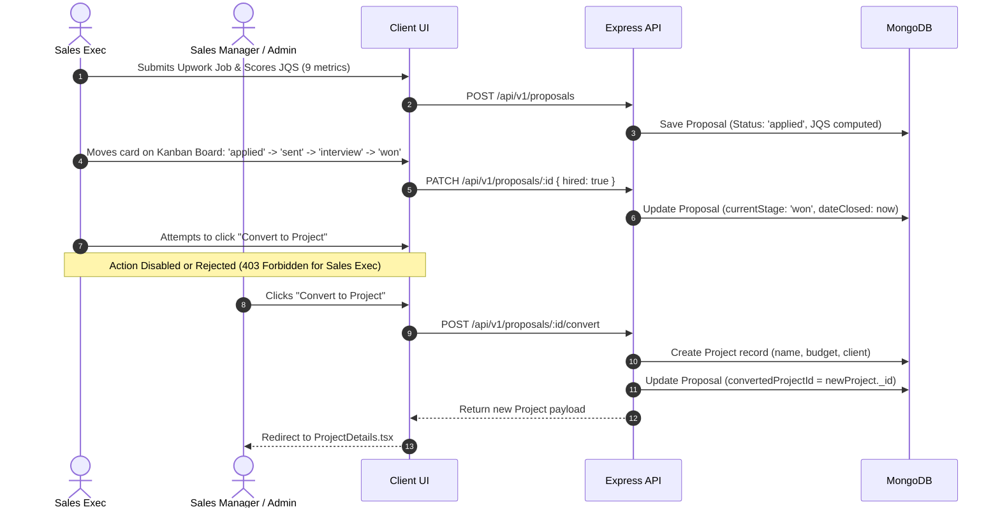

# Webblaze PMS (WBS-PMS) — Complete Technical & Architectural Specification Manual

> **Document Type**: Comprehensive Master Engineering Reference & System Architecture Specification  
> **Target Audience**: Full-Stack Engineers, Software Test Architects, System Architects, QA Engineers, and Technical Leads  
> **System Name**: Webblaze Project Management System & Sales CRM (`WBS-PMS`)  
> **Repository Path**: `D:\Webblaze PMS\WBS-PMS`  
> **Last Updated**: October 2026 | Production Version: 1.0.0  

---

## Table of Contents
1. [Executive Summary & High-Level System Architecture](#1-executive-summary--high-level-system-architecture)
2. [Complete Monorepo Directory & File Catalog](#2-complete-monorepo-directory--file-catalog)
3. [Database Architecture & Data Models (Full Schema & Invariants)](#3-database-architecture--data-models)
4. [Authentication, Security & Session Lifecycle](#4-authentication-security--session-lifecycle)
5. [Role-Based Access Control (RBAC) & Defense-in-Depth](#5-role-based-access-control-rbac--defense-in-depth)
6. [Detailed Backend API Catalog (Module by Module)](#6-detailed-backend-api-catalog)
7. [Frontend Architecture & Feature Inventory](#7-frontend-architecture--feature-inventory)
8. [End-to-End Business Workflows & State Machines](#8-end-to-end-business-workflows--state-machines)
9. [Cross-Cutting Patterns & Shared Utilities](#9-cross-cutting-patterns--shared-utilities)
10. [Testing Framework & Quality Assurance Baseline](#10-testing-framework--quality-assurance-baseline)
11. [Developer Onboarding, Setup & Operational Runbook](#11-developer-onboarding-setup--operational-runbook)

---

## 1. Executive Summary & High-Level System Architecture

### 1.1 Purpose & Vision
**Webblaze PMS (`WBS-PMS`)** is an enterprise-grade digital agency operating platform combining **Top-of-Funnel Sales CRM** (Upwork proposal pipeline, Job Quality Scoring, connect expenditure) and **Delivery Project Management** (clients, milestones, hour-budgeted tasks, live timers, team todos, deployment releases, and invoicing).

The platform eliminates the operational disconnect between what sales teams promise and what engineering teams deliver by tying sales proposals directly into project creation, enforcing milestone hour limits, tracking granular time down to the second, and providing real-time financial reconciliation.

### 1.2 Core Architectural Principles
1. **Full-Stack TypeScript**: Strict typing across Express routes, Mongoose models, Zod validation schemas, Redux Toolkit slices, and Mantine UI forms.
2. **Feature-First Backend Structure**: Every module in `server/src/modules/<feature>` encapsulates its own model, controller, service, routes, validation schema, and unit tests.
3. **Four-Tier Defense-in-Depth**:
   - *Tier 1 (UI)*: Frontend route guards (`RoleGuard`, `ProtectedRoute`) conditionally render interfaces.
   - *Tier 2 (HTTP)*: Express middlewares (`authMiddleware`, `rbacMiddleware`) block unauthorized calls.
   - *Tier 3 (Database Scoping)*: Services filter queries at the database level (`query.team = user._id`, `query.salesExec = user._id`).
   - *Tier 4 (Financial Stripping)*: Service layer scrubs sensitive budgets, rates, and profits from response objects for non-managerial roles.
4. **Milestone Hour-Capping**: Server-side mathematical invariant preventing tasks from being scheduled beyond a milestone's budgeted hours:
   $$\sum (\text{Sibling Tasks Estimated Hours}) + \text{New Task Estimated Hours} \le \text{Milestone Estimated Hours}$$
5. **Single Active Running Timer**: Enforces that a user can only have one running timer at any given moment across all projects. Starting a timer auto-stops any open timer and clamps duration to the task's remaining estimate.
6. **Automatic Status Rollups**: Status transitions propagate bottom-up: TimeLog → Task Status (`in_review` / `completed`) → Milestone Status (`completed`) → Project Delivery Progress ($\% = \frac{\sum \text{spentHours}}{\sum \text{estimatedHours}} \times 100$).

### 1.3 High-Level System Architecture Diagram

```
┌─────────────────────────────────────────────────────────────────────────────────┐
│                     React 18 Frontend (Vite + TypeScript)                       │
│  ├── Mantine UI v7 Components (Modals, Drawers, DatePickers, Notifications)    │
│  ├── Redux Toolkit (RTK Query) with Tag-based Invalidation & Auto-Reauth        │
│  ├── @dnd-kit Sortable Kanban Board (Sales Proposals Pipeline)                 │
│  ├── Global Header Timer Badge (Live polling & single-click stop)               │
│  ├── Global Search Modal (Ctrl+K omnibar across projects, tasks, clients)       │
│  └── Declarative RoleGuards & Protected Route Tree                             │
└────────────────────────────────────────┬────────────────────────────────────────┘
                                         │ HTTPS / REST (JSON + Cookies)
                                         ▼
┌─────────────────────────────────────────────────────────────────────────────────┐
│                        Node.js / Express 4 API Gateway                          │
│  ├── Helmet (Security Headers)           ├── CORS (Origin Whitelist)            │
│  ├── Express JSON & Cookie Parser        ├── Winston Structured Logger          │
│  ├── JWT Authentication Middleware       ├── RBAC Authorization Middleware      │
│  ├── Zod Request Schema Validation       └── Centralized Error Handling Handler │
└────────────────────────┬───────────────────────────────┬────────────────────────┘
                         │                               │
                         ▼                               ▼
┌─────────────────────────────────────────┐   ┌───────────────────────────────────┐
│       MongoDB Database (Mongoose 8)     │   │      External Cloud Services      │
│  - 12 Relational & Scoped Schemas       │   │  - Nodemailer (SMTP / Mock Logger)│
│  - Mongoose Pre/Post Save Hooks         │   │  - Multer File Uploads (Disk/S3)  │
│  - Automated Cascading Purge Cleanups   │   │  - (Planned) Socket.io Live Sync  │
└─────────────────────────────────────────┘   └───────────────────────────────────┘
```

---

## 2. Complete Monorepo Directory & File Catalog

```
d:/Webblaze PMS/WBS-PMS/
├── client/                                     # React 18 Frontend
│   ├── src/
│   │   ├── app/
│   │   │   ├── api.ts                          # Base RTK Query API slice with auto-reauth
│   │   │   └── store.ts                        # Redux Toolkit root store configuration
│   │   ├── components/common/
│   │   │   ├── ActiveTimerBadge.tsx            # Global ticking timer in navbar
│   │   │   ├── BlazeLogo.tsx                   # SVG brand typography logo
│   │   │   ├── DeleteConfirmModal.tsx          # Standardized 2-step destructive action modal
│   │   │   ├── GlobalSearchModal.tsx           # Ctrl+K global search across all entities
│   │   │   ├── GuestRoute.tsx                  # Public-only route wrapper (redirects if logged in)
│   │   │   ├── ProtectedRoute.tsx              # Authenticated-only route wrapper
│   │   │   ├── RoleGuard.tsx                   # Role-based conditional UI and route guard
│   │   │   ├── UserAvatar.tsx                  # Standardized avatar with fallback initials
│   │   │   └── PaginatedTable/
│   │   │       ├── PaginatedTable.tsx          # Universal data table with Mantine styles
│   │   │       ├── Pagination.tsx              # Page buttons and limit selector
│   │   │       └── usePagination.ts            # Hook synchronizing pagination with URL search params
│   │   ├── features/
│   │   │   ├── auth/                           # Login, ForgotPassword, ResetPassword, auth.slice.ts
│   │   │   ├── clients/                        # ClientsList.tsx, ClientDetail.tsx, client.slice.ts
│   │   │   ├── dailyStatus/                    # DailyStatus.tsx, dailyStatus.slice.ts
│   │   │   ├── dashboard/                      # DashboardShell.tsx, SalesDashboard.tsx, ReleaseSheet.tsx, ProjectSummaryCards.tsx, TeamTimeTrackingPanel.tsx
│   │   │   ├── invoices/                       # InvoicesPage.tsx, invoice.slice.ts
│   │   │   ├── milestones/                     # MilestoneCreatePage.tsx, MilestoneDetailPage.tsx, MilestoneEditPage.tsx, milestone.slice.ts
│   │   │   ├── projects/                       # ProjectsList.tsx, ProjectDetails.tsx (117KB hub), project.slice.ts
│   │   │   ├── proposals/                      # ProposalsList.tsx, ProposalsBoard.tsx (@dnd-kit), ProposalDetail.tsx, proposalApi.ts, types.ts
│   │   │   ├── releases/                       # ReleasesPage.tsx, release.slice.ts
│   │   │   ├── reports/                        # ReportsPage.tsx (analytics, hours distribution)
│   │   │   ├── settings/                       # SettingsPage.tsx (user preferences, account details)
│   │   │   ├── tasks/                          # MyTasks.tsx, TeamTasks.tsx, TaskCreatePage.tsx, TaskDetail.tsx, TaskTable.tsx, task.slice.ts
│   │   │   ├── timelogs/                       # TeamTimeTracking.tsx, timeLog.slice.ts
│   │   │   ├── uploads/                        # upload.slice.ts
│   │   │   └── users/                          # UsersList.tsx, UserProfile.tsx, user.slice.ts
│   │   ├── layouts/
│   │   │   └── DashboardLayout.tsx             # Responsive sidebar, navigation categories, header
│   │   ├── routes/
│   │   │   └── index.tsx                       # Complete declarative React Router route tree
│   │   ├── types/
│   │   │   └── index.ts                        # Shared client-side interfaces and enums
│   │   ├── utils/
│   │   │   ├── dateUtils.ts                    # Day.js date formatters
│   │   │   └── formatHours.ts                  # Hour/minute string converter
│   │   ├── index.css                           # Global CSS, Mantine overrides, custom scrollbars
│   │   └── main.tsx                            # React root mount with MantineProvider & Redux Provider
│   ├── package.json
│   ├── tsconfig.json
│   └── vite.config.ts
│
├── server/                                     # Express 4 Backend API
│   ├── src/
│   │   ├── config/
│   │   │   ├── db.ts                           # Mongoose connection with error handling
│   │   │   ├── permissions.ts                  # Resource-to-role permissions mapping
│   │   │   └── salesCrmConfig.ts               # Sales thresholds (JQS score, follow-up intervals)
│   │   ├── middlewares/
│   │   │   ├── auth.middleware.ts              # Bearer token verification & tokenVersion check
│   │   │   ├── errorHandler.middleware.ts      # Global API error handler & logger
│   │   │   ├── rbac.middleware.ts              # Role authorization gate
│   │   │   └── validate.middleware.ts          # Zod schema request validator
│   │   ├── modules/
│   │   │   ├── auth/                           # auth.controller.ts, auth.service.ts, auth.routes.ts, auth.validation.ts
│   │   │   ├── clients/                        # client.controller.ts, client.service.ts, client.model.ts, client.routes.ts, client.validation.ts
│   │   │   ├── daily-status/                   # dailyStatus.controller.ts, dailyStatus.service.ts, dailyStatus.model.ts, dailyStatus.routes.ts, dailyStatus.validation.ts
│   │   │   ├── invoices/                       # invoice.controller.ts, invoice.service.ts, invoice.model.ts, invoice.routes.ts, invoice.validation.ts
│   │   │   ├── milestones/                     # milestone.controller.ts, milestone.service.ts, milestone.model.ts, milestone.routes.ts, milestone.validation.ts
│   │   │   ├── projects/                       # project.controller.ts, project.service.ts, project.model.ts, project.routes.ts, project.validation.ts
│   │   │   ├── proposals/                      # proposal.controller.ts, proposal.service.ts, proposal.model.ts, proposal.routes.ts, proposal.validation.ts, proposal.model.test.ts, proposal.rbac.test.ts, proposal.service.test.ts
│   │   │   ├── releases/                       # release.controller.ts, release.service.ts, release.model.ts, release.routes.ts, release.validation.ts
│   │   │   ├── tasks/                          # task.controller.ts, task.service.ts, task.model.ts, task.routes.ts, task.validation.ts
│   │   │   ├── timelogs/                       # timeLog.controller.ts, timeLog.service.ts, timeLog.model.ts, timeLog.routes.ts, timeLog.validation.ts
│   │   │   ├── uploads/                        # upload.routes.ts, attachment.model.ts
│   │   │   └── users/                          # user.controller.ts, user.service.ts, user.model.ts, user.routes.ts, user.seeder.ts
│   │   ├── types/
│   │   │   └── index.ts                        # Enums: Role, Department, ProjectStatus, TaskStatus, MilestoneStatus
│   │   ├── utils/
│   │   │   ├── ApiError.ts                     # Custom error class with HTTP status & errorCode
│   │   │   ├── asyncHandler.ts                 # Async Express wrapper catching rejected promises
│   │   │   ├── department.ts                   # Department normalization & alias regex helper
│   │   │   ├── emailService.ts                 # Nodemailer dispatcher with HTML templates & dev mode logger
│   │   │   ├── logger.ts                       # Winston logger setup
│   │   │   └── paginate.ts                     # Universal MongoDB pagination helper
│   │   ├── app.ts                              # Express app configuration & middleware pipeline
│   │   ├── server.ts                           # Server startup listener
│   │   └── seed.ts                             # CLI admin database seeder
│   ├── package.json
│   ├── tsconfig.json
│   └── jest.config.js
│
├── e2e/                                        # Playwright End-to-End Suite
│   ├── auth.setup.ts                           # Global authentication setup (captures `admin.json`)
│   ├── auth.spec.ts                            # Login & authorization redirection tests
│   ├── clients.spec.ts                         # Client CRUD tests
│   ├── projects.spec.ts                        # Project creation & overview tests
│   ├── releases.spec.ts                        # Releases schedule & detail tests
│   ├── tasks.spec.ts                           # Task creation & assignment tests
│   └── pages/
│       └── LoginPage.ts                        # Page Object Model for login
│
├── playwright.config.ts                        # Playwright configuration
├── ARCHITECTURE.md                             # Architectural foundation notes
├── RBAC_MATRIX.md                              # Role matrix reference
├── API_ENDPOINTS.md                            # API endpoints quick reference
├── DATABASE_SCHEMA.md                          # Schema quick reference
├── PAGINATION_PLAN.md                          # Standard pagination specification
└── SALES_CRM_PLAN.md                           # Sales CRM specification
```

---

## 3. Database Architecture & Data Models

All models are defined in Mongoose with `{ timestamps: true }`, creating automatic `createdAt` and `updatedAt` fields. `ObjectId` references are strictly typed to enable `.populate()`.

### 3.1 `User` Model (`server/src/modules/users/user.model.ts`)
Stores platform users, credentials, role assignments, and session revocation markers.

| Field | Type | Attributes | Description |
|---|---|---|---|
| `name` | String | required, trim | User's full name |
| `email` | String | required, unique, lowercase, trim | Authentication email |
| `password` | String | select: false | Bcrypt hash (salt rounds = 10) |
| `role` | String | enum: `Role`, required | One of the 6 system roles |
| `department` | String | enum: `Department`, optional | Operational team assignment |
| `isActive` | Boolean | default: true | Account active/disabled flag |
| `avatarUrl` | String | optional | Image profile path |
| `tokenVersion` | Number | default: 0 | Session revocation counter |
| `resetPasswordToken`| String | select: false | Cryptographic random token |
| `resetPasswordExpires`| Date | select: false | Password reset expiration timestamp (1 hour) |

- **Hooks & Methods**:
  - `pre('save')`: Hashes `password` using `bcrypt.genSalt(10)` only when modified.
  - `methods.comparePassword(candidate)`: Validates plaintext input against bcrypt hash.
  - `toJSON`: Strips `password`, `resetPasswordToken`, and `resetPasswordExpires` from serialization.

### 3.2 `Client` Model (`server/src/modules/clients/client.model.ts`)
Stores client company and billing information.

| Field | Type | Attributes | Description |
|---|---|---|---|
| `name` | String | required, trim | Primary contact name |
| `email` | String | trim, lowercase | Primary contact email |
| `companyName` | String | trim | Organization / brand name |
| `contactNumber` | String | trim | Phone / WhatsApp number |
| `address` | String | trim | Physical address |
| `country` | String | trim | Country of operation |
| `source` | String | enum: `['upwork', 'direct', 'referral', 'linkedin', 'other']` | Lead acquisition channel |
| `billingType` | String | enum: `['hourly', 'fixed']`, default: `hourly` | Default invoicing model |
| `createdBy` | ObjectId | ref: `User`, required | Admin/PM who created the record |

### 3.3 `Project` Model (`server/src/modules/projects/project.model.ts`)
The central entity for project delivery. Holds budget, team, status, and client relationships.

| Field | Type | Attributes | Description |
|---|---|---|---|
| `name` | String | required, trim | Project title |
| `client` | ObjectId | ref: `Client`, required | Client relationship |
| `totalBudget` | Number | min: 0 | Total agreed financial budget (financial field) |
| `costPerHour` | Number | min: 0 | Internal cost rate per hour (financial field) |
| `totalHours` | Number | min: 0 | Estimated total project hours |
| `receivedAmount` | Number | default: 0 | Paid invoice rollup (financial field) |
| `pendingAmount` | Number | default: 0 | Unpaid invoice rollup (financial field) |
| `description` | String | trim | Project scope / notes |
| `type` | String | trim | Department string (e.g. `fullstack`, `seo`) |
| `status` | String | enum: `ProjectStatus`, default: `active` | `new`, `active`, `on_hold`, `maintenance`, `completed` |
| `team` | [ObjectId] | ref: `User` | Assigned team members |
| `createdBy` | ObjectId | ref: `User`, required | Creator |

- **Core Service Logic (`ProjectService`)**:
  - `stripFinancials(project, userRole)`: Deletes `totalBudget`, `costPerHour`, `totalHours`, `receivedAmount`, and `pendingAmount` for any role other than `ADMIN` or `PM`.
  - `attachProgress(project)`: Queries child milestones, aggregates `estHours` and `spentHours`, and appends `progress = (spentHours / estHours) * 100`.
  - `deleteProject(id)`: Cascading purge of all child Milestones, Tasks, TimeLogs, Releases, Invoices, and DailyStatus records.

### 3.4 `Milestone` Model (`server/src/modules/milestones/milestone.model.ts`)
Divides projects into budgeted delivery phases.

| Field | Type | Attributes | Description |
|---|---|---|---|
| `project` | ObjectId | ref: `Project`, required, index | Parent project |
| `title` | String | required, trim | Milestone name |
| `estimatedHours` | Number | required, min: 0 | Maximum hour budget for all child tasks |
| `spentHours` | Number | default: 0 | Auto-aggregated from task time logs |
| `startDate` | Date | optional | Scheduled start date |
| `endDate` | Date | optional | Scheduled delivery deadline |
| `status` | String | enum: `MilestoneStatus`, default: `not_started` | `not_started`, `in_progress`, `on_hold`, `completed`, `cancelled` |

- **Automatic Rollup (`evaluateAndUpdateMilestoneStatus`)**:
  - Evaluates all child tasks.
  - If `spentHours >= estimatedHours` OR all tasks are completed, milestone status automatically flips to `completed`.
  - If any task is `in_progress` or `in_review`, status flips to `in_progress`.

### 3.5 `Task` Model (`server/src/modules/tasks/task.model.ts`)
Actionable work units assigned to individual developers or team leads.

| Field | Type | Attributes | Description |
|---|---|---|---|
| `milestone` | ObjectId | ref: `Milestone`, required, index | Parent milestone |
| `title` | String | required, trim | Task name |
| `description` | String | trim | Detailed acceptance criteria |
| `department` | String | enum: `['seo', 'fullstack', 'design', 'shopify', 'wordpress', 'sales', 'pm', 'admin']` | Assigned department |
| `estimatedHours` | Number | required, min: 0.5 | Task hour allocation |
| `spentHours` | Number | default: 0 | Actual hours tracked via timers |
| `startDate` | Date | optional | Scheduled start |
| `endDate` | Date | optional | Scheduled completion |
| `assignedTo` | ObjectId | ref: `User`, optional, index | Assigned team member |
| `status` | String | enum: `TaskStatus`, default: `assigned` | `assigned`, `in_progress`, `in_review`, `completed` |
| `attachments` | [ObjectId] | ref: `Attachment` | Uploaded reference documents |
| `createdBy` | ObjectId | ref: `User`, required | Creator |

- **Business Invariant (`enforceHourCap`)**:
  ```ts
  const siblingTasks = await Task.find({ milestone: milestoneId, _id: { $ne: currentTaskId } });
  const sumOfSiblingHours = siblingTasks.reduce((sum, task) => sum + task.estimatedHours, 0);
  if (sumOfSiblingHours + estimatedHours > milestone.estimatedHours) {
    throw new ApiError(400, `Task exceeds milestone budget: ${milestone.estimatedHours}h`);
  }
  ```

### 3.6 `TimeLog` Model (`server/src/modules/timelogs/timeLog.model.ts`)
Records granular time tracking down to the second.

| Field | Type | Attributes | Description |
|---|---|---|---|
| `task` | ObjectId | ref: `Task`, required, index | Tracked task |
| `user` | ObjectId | ref: `User`, required, index | User who tracked time |
| `startTime` | Date | required | Timer initiation timestamp |
| `endTime` | Date | optional | Timer completion timestamp |
| `durationSeconds`| Number | default: 0 | Total tracked duration in seconds |
| `description` | String | trim | Work description / note |

- **Single Active Timer Rule**:
  - `startTimer`: Finds any active timer for `userId` where `endTime: { $exists: false }` and calls `stopTimer` on it first before opening a new log.
  - Clamping: Duration is clamped so it does not exceed the task's remaining estimate.
  - Auto-Transitions: Starting a timer advances `assigned` tasks to `in_progress`. Stopping a timer at or past the estimated limit advances the task to `in_review`.

### 3.7 `Release` Model (`server/src/modules/releases/release.model.ts`)
Tracks software deployments and QA releases.

| Field | Type | Attributes | Description |
|---|---|---|---|
| `project` | ObjectId | ref: `Project`, required, index | Associated project |
| `department` | String | enum: `Department`, required | Responsible department |
| `teamMember` | ObjectId | ref: `User`, optional | Release owner |
| `details` | String | required, trim | Release notes / changelog |
| `releaseDate` | Date | required, index | Deployment date |
| `status` | String | enum: `['draft', 'scheduled', 'in_review', 'released']`, default: `draft` | Deployment state |
| `createdBy` | ObjectId | ref: `User`, required | Creator |

### 3.8 `Invoice` Model (`server/src/modules/invoices/invoice.model.ts`)
Financial invoicing and payment tracking for clients.

| Field | Type | Attributes | Description |
|---|---|---|---|
| `project` | ObjectId | ref: `Project`, required, index | Billed project |
| `invoiceNumber` | String | required, unique, trim, index | Unique invoice identifier |
| `issueDate` | Date | required | Date of invoice generation |
| `dueDate` | Date | required | Payment deadline |
| `totalAmount` | Number | required, min: 0 | Total payable sum |
| `receivedAmount` | Number | default: 0, min: 0 | Total payments collected |
| `pendingAmount` | Number | default: calculated | Balance remaining |
| `status` | String | enum: `['draft', 'sent', 'partially_paid', 'paid', 'overdue']`, default: `draft` | Invoicing status |
| `paymentDetails` | [Subdocument] | Array of `{ paymentDate, method, transactionId, amount }` | Payment history ledger |
| `createdBy` | ObjectId | ref: `User`, required | Creator |

- **Lifecycle Automation**:
  - In `pre('save')`, `pendingAmount` is recalculated. If `pendingAmount <= 0`, status becomes `paid`. If `receivedAmount > 0`, status becomes `partially_paid`.
  - In `invoice.service.ts`, `updateProjectFinancials(projectId)` recalculates total `receivedAmount` and `pendingAmount` on the parent Project across all non-draft invoices.

### 3.9 `DailyStatus` Model (`server/src/modules/daily-status/dailyStatus.model.ts`)
Daily developer work logs and blockers.

| Field | Type | Attributes | Description |
|---|---|---|---|
| `user` | ObjectId | ref: `User`, required, index | Submitting developer |
| `project` | ObjectId | ref: `Project`, optional, index | Related project |
| `workDone` | String | required, trim | Completed tasks summary |
| `plannedWork` | String | trim, default: '' | Next day plans |
| `blockers` | String | trim, default: '' | Current technical/process blockers |
| `date` | Date | required, default: Date.now, index | Submission date |

### 3.10 `Proposal` Model (`server/src/modules/proposals/proposal.model.ts`)
Comprehensive Upwork and Agency Sales CRM pipeline record.

- **Identity & Discovery**:
  - `proposalCode` (e.g. `PROP-2026-001`), `dateFound`, `dateApplied`, `salesExec` (ref `User`), `upworkProfile`, `jobTitle`, `jobUrl`, `clientName`, `clientCountry`, `clientIndustry`, `serviceCategory`, `jobType` (`fixed_price` / `hourly`), `jobBudget`, `estimatedProjectValue`, `paymentVerified`.
- **Job Quality Score (JQS)** (Average calculated automatically):
  - `jqs.skillFit`, `jqs.budgetFit`, `jqs.clientQuality`, `jqs.jobClarity`, `jqs.portfolioFit`, `jqs.hiringProbability`, `jqs.competitionScore`, `jqs.timingScore`, `jqs.historicalActivity`.
  - `jobQualityScore`: Mean average of JQS subfields.
  - `qualified`: Boolean flag (`jobQualityScore >= 7` or `qualifiedOverride`).
- **Proposal Quality Score (PQS)**:
  - `pqs.jobFit`, `pqs.personalization`, `pqs.relevantProof`, `pqs.solutionClarity`, `pqs.ctaStrength`, `pqs.painPointAlignment`.
  - `proposalQualityScore`: Mean average of PQS subfields.
- **Connects & Investment**:
  - `connectsUsed`, `boostConnects`, `totalConnects` (sum), `connectCost`, `boostedVsOrganic`.
- **Pipeline Checkpoints**:
  - `proposalSent`, `proposalViewed`, `clientReplied`, `interviewScheduled`, `followUp1Done`, `followUp2Done`, `followUp3Done`, `offerReceived`, `hired`, `lost`, `noResponse`.
  - `currentStage`: Priority-evaluated stage: `won` > `lost` > `offer` > `interview` > `replied` > `viewed` > `sent` > `applied`.
- **Conversion Tracking**:
  - `convertedProjectId` (ref `Project`), `dateClosed`, `wonRevenue`, `salesCycleDays`.

### 3.11 `Attachment` Model (`server/src/modules/uploads/attachment.model.ts`)
Stores metadata for uploaded documents and screenshots.

| Field | Type | Attributes | Description |
|---|---|---|---|
| `filename` | String | required | Server disk filename |
| `originalName` | String | required | User's local file name |
| `mimeType` | String | required | MIME type (e.g. `application/pdf`, `image/png`) |
| `sizeBytes` | Number | required | File size in bytes |
| `url` | String | required | Publicly accessible URL |
| `uploadedBy` | ObjectId | ref: `User`, required | Uploader |
| `relatedType` | String | enum: `['Task', 'Project']`, required | Association entity |
| `relatedId` | ObjectId | required | ID of related task or project |

---

## 4. Authentication, Security & Session Lifecycle

### 4.1 Token Architecture
The system implements a dual-token JWT mechanism:
1. **Access Token**:
   - Lifetime: **15 minutes**.
   - Payload: `{ id: user._id, role: user.role, tokenVersion: user.tokenVersion }`.
   - Transport: `Authorization: Bearer <token>` HTTP header.
2. **Refresh Token**:
   - Lifetime: **7 days**.
   - Payload: `{ id: user._id }`.
   - Transport: Set in `httpOnly`, `sameSite: 'lax'` secure cookie (also supported via JSON body `{ refreshToken }` for cross-origin deployments).

### 4.2 Immediate Session Revocation (`tokenVersion`)
To prevent compromised tokens from accessing the platform:
- The `User` model stores `tokenVersion: number`.
- Inside [`authMiddleware`](file:///d:/Webblaze%20PMS/WBS-PMS/server/src/middlewares/auth.middleware.ts#L21):
  ```ts
  if (decoded.tokenVersion !== undefined && decoded.tokenVersion !== (user.tokenVersion || 0)) {
    throw new ApiError(401, 'User role or session updated. Please log in again.');
  }
  ```
- Whenever an admin modifies a user's role, deactivates a user (`isActive = false`), or a user changes their password, `tokenVersion` is incremented. All existing access tokens are instantly invalidated.

### 4.3 Automated Client-Side Re-Authentication
In [`client/src/app/api.ts`](file:///d:/Webblaze%20PMS/WBS-PMS/client/src/app/api.ts#L16-L50), RTK Query wraps requests in `baseQueryWithReauth`:
1. Executes original HTTP request.
2. If response status is `401 Unauthorized`:
   - Intercepts error and calls `POST /api/v1/auth/refresh`.
   - If refresh succeeds: Dispatches `auth/updateToken`, stores new token pair in Redux, and automatically retries the initial failed request.
   - If refresh fails: Dispatches `auth/logoutLocally` and redirects the user to `/login`.

### 4.4 Password Recovery & Invitation Service
The [`emailService.ts`](file:///d:/Webblaze%20PMS/WBS-PMS/server/src/utils/emailService.ts) module integrates Nodemailer:
- Produces custom branded HTML emails for:
  1. **Password Reset Requests**: Contains a secure 1-hour expiration link.
  2. **User Workspace Invitations**: Contains a temporary password and portal link.
  3. **Task Assignment Notices**: Notifies team members of new task assignments with estimated hours and direct link.
  4. **Task Status Change Alerts**: Notifies leads when tasks move to `in_review` or `completed`.
- **Development Fallback**: If SMTP variables are missing, `emailService.ts` logs an ASCII notification block in the server terminal with the direct link rather than crashing.

---

## 5. Role-Based Access Control (RBAC) & Defense-in-Depth

### 5.1 System Roles & Definitions
The system is partitioned into **6 Roles**:
1. [`Role.ADMIN`](file:///d:/Webblaze%20PMS/WBS-PMS/server/src/types/index.ts#L3) (`'admin'`): Complete super-administrator access across all modules, user administration, financial data, and configurations.
2. [`Role.PM`](file:///d:/Webblaze%20PMS/WBS-PMS/server/src/types/index.ts#L4) (`'pm'`): Project Manager. Full operational and financial management of projects, clients, milestones, tasks, releases, and invoices. Cannot manage users or platform settings.
3. [`Role.TEAM_LEAD`](file:///d:/Webblaze%20PMS/WBS-PMS/server/src/types/index.ts#L5) (`'team_lead'`): Team Lead. Scoped to assigned projects and departmental team members. Can create and assign tasks within their team, view milestones, and track time. **Strictly forbidden from viewing financial budgets or invoices.**
4. [`Role.TEAM_MEMBER`](file:///d:/Webblaze%20PMS/WBS-PMS/server/src/types/index.ts#L6) (`'team_member'`): Developer / Specialist. Scoped strictly to their own assigned projects and tasks. Can start/stop task timers, transition task statuses, and submit daily standups. **Strictly forbidden from viewing financial data.**
5. [`Role.SALES_MANAGER`](file:///d:/Webblaze%20PMS/WBS-PMS/server/src/types/index.ts#L8) (`'sales_manager'`): Sales Leadership. Full management across all Sales CRM proposals, KPI dashboards, and connect budgets. **Authorized to convert won proposals into PMS projects.**
6. [`Role.SALES_EXEC`](file:///d:/Webblaze%20PMS/WBS-PMS/server/src/types/index.ts#L7) (`'sales_exec'`): Sales Representative. Scoped strictly to creating and managing their own proposals and viewing their own individual KPI performance. **Forbidden from converting proposals to projects.**

### 5.2 Four-Layer Defense-in-Depth Enforcement

```
┌─────────────────────────────────────────────────────────────┐
│ Tier 1: Frontend Route & UI Guards                          │
│ RoleGuard.tsx & DashboardLayout.tsx filter navigation links │
└──────────────────────────────┬──────────────────────────────┘
                               │ HTTP Request
                               ▼
┌─────────────────────────────────────────────────────────────┐
│ Tier 2: Express Route Middleware                            │
│ rbacMiddleware([allowedRoles]) throws 403 Forbidden         │
└──────────────────────────────┬──────────────────────────────┘
                               │ Validated Role
                               ▼
┌─────────────────────────────────────────────────────────────┐
│ Tier 3: Service Layer Database Scoping                      │
│ query.team = user._id & query.salesExec = user._id          │
└──────────────────────────────┬──────────────────────────────┘
                               │ Raw DB Record
                               ▼
┌─────────────────────────────────────────────────────────────┐
│ Tier 4: Financial Data Sanitization                         │
│ stripFinancials() deletes budgets & rates in memory         │
└─────────────────────────────────────────────────────────────┘
```

### 5.3 Complete 50+ Endpoint Authorization & Permission Matrix

| HTTP Method | API Endpoint | Primary Function | Allowed Roles | Scoping / Invariants |
|---|---|---|---|---|
| `POST` | `/api/v1/auth/login` | User login | **Public** | Validates email/password |
| `POST` | `/api/v1/auth/refresh` | Token refresh | **Public** | Validates refresh token |
| `POST` | `/api/v1/auth/logout` | User logout | **Public** | Clears refresh cookie |
| `POST` | `/api/v1/auth/forgot-password` | Request reset | **Public** | Generates 1h reset token |
| `POST` | `/api/v1/auth/reset-password` | Set new password | **Public** | Verifies token & updates password |
| `POST` | `/api/v1/auth/register` | Create user | `admin` | Admin creates user credentials |
| `GET` | `/api/v1/auth/me` | Fetch active user | **Authenticated** | Returns authenticated profile |
| `POST` | `/api/v1/auth/change-password` | Change password | **Authenticated** | Increments `tokenVersion` |
| `GET` | `/api/v1/users` | List all users | `admin`, `pm` | Directory view |
| `GET` | `/api/v1/users/:id` | Get user profile | `admin`, `pm`, self | Self or admin inspection |
| `PATCH` | `/api/v1/users/:id` | Update user | `admin` | Edits role, department, status |
| `GET` | `/api/v1/clients` | List clients | `admin`, `pm` | Paginated client list |
| `POST` | `/api/v1/clients` | Create client | `admin`, `pm` | Validates billing type |
| `GET` | `/api/v1/clients/:id` | Get client detail | `admin`, `pm` | Returns client & projects |
| `PATCH` | `/api/v1/clients/:id` | Update client | `admin`, `pm` | Modifies contact details |
| `DELETE`| `/api/v1/clients/:id` | Delete client | `admin`, `pm` | Removes client |
| `GET` | `/api/v1/projects` | List projects | `admin`, `pm`, `team_lead`, `team_member` | Scoped to assigned `team` for TL/TM; financials stripped |
| `POST` | `/api/v1/projects` | Create project | `admin`, `pm` | Sets budget, team, client |
| `GET` | `/api/v1/projects/:id` | Get project detail | `admin`, `pm`, `team_lead`, `team_member` | Throws 403 if TL/TM not in `team`; financials stripped |
| `PATCH` | `/api/v1/projects/:id` | Update project | `admin`, `pm` | Modifies team, status, budget |
| `DELETE`| `/api/v1/projects/:id` | Delete project | `admin`, `pm` | Cascades delete to milestones, tasks, logs |
| `GET` | `/api/v1/projects/:projectId/milestones` | List milestones | `admin`, `pm`, `team_lead`, `team_member` | Scoped to assigned projects |
| `POST` | `/api/v1/milestones` | Create milestone | `admin`, `pm` | Sets title & `estimatedHours` |
| `GET` | `/api/v1/milestones/:id` | Get milestone | `admin`, `pm`, `team_lead`, `team_member` | Re-evaluates milestone status |
| `PATCH` | `/api/v1/milestones/:id` | Update milestone | `admin`, `pm` | Updates status or hour budget |
| `DELETE`| `/api/v1/milestones/:id` | Delete milestone | `admin`, `pm` | Removes milestone |
| `GET` | `/api/v1/tasks` | List all tasks | `admin`, `pm`, `team_lead`, `team_member` | Scoped to assigned projects for TL/TM |
| `POST` | `/api/v1/tasks` | Create task | `admin`, `pm`, `team_lead` | **Enforces milestone hour-cap** |
| `GET` | `/api/v1/tasks/:id` | Get task detail | `admin`, `pm`, `team_lead`, `team_member` | Scoped to project team |
| `PATCH` | `/api/v1/tasks/:id` | Update task | `admin`, `pm`, `team_lead`, `team_member` | TM can only edit own assigned tasks |
| `DELETE`| `/api/v1/tasks/:id` | Delete task | `admin`, `pm`, `team_lead` | Removes task |
| `POST` | `/api/v1/timelogs/start` | Start live timer | `admin`, `pm`, `team_lead`, `team_member` | Auto-stops previous timer; clamps estimate |
| `POST` | `/api/v1/timelogs/stop` | Stop live timer | `admin`, `pm`, `team_lead`, `team_member` | Rolls up spent hours to task & milestone |
| `GET` | `/api/v1/timelogs/active` | Get current timer | `admin`, `pm`, `team_lead`, `team_member` | Scoped to `req.user._id` |
| `GET` | `/api/v1/timelogs` | List time logs | `admin`, `pm`, `team_lead`, `team_member` | Scoped to own logs for TM; team for TL |
| `POST` | `/api/v1/timelogs/manual`| Add manual log | `admin`, `pm` | Backfills time log |
| `GET` | `/api/v1/releases` | List releases | `admin`, `pm`, `team_lead`, `team_member` | Scoped to project team |
| `POST` | `/api/v1/releases` | Create release | `admin`, `pm`, `team_lead` | Creates deployment schedule |
| `PATCH` | `/api/v1/releases/:id` | Update release | `admin`, `pm`, `team_lead` | Changes release status |
| `DELETE`| `/api/v1/releases/:id` | Delete release | `admin`, `pm` | Removes release |
| `GET` | `/api/v1/invoices` | List invoices | `admin`, `pm` | **403 for TL, TM, Sales** |
| `POST` | `/api/v1/invoices` | Create invoice | `admin`, `pm` | Auto-computes pending balance |
| `GET` | `/api/v1/invoices/:id` | Get invoice | `admin`, `pm` | Full invoice and payment ledger |
| `PATCH` | `/api/v1/invoices/:id` | Update invoice | `admin`, `pm` | Adds payments; updates project totals |
| `DELETE`| `/api/v1/invoices/:id` | Delete invoice | `admin`, `pm` | Rolls back project financials |
| `GET` | `/api/v1/daily-status` | List standups | `admin`, `pm`, `team_lead`, `team_member` | Scoped by date and team |
| `POST` | `/api/v1/daily-status` | Submit standup | `admin`, `pm`, `team_lead`, `team_member` | Creates workDone & blockers entry |
| `GET` | `/api/v1/proposals` | List proposals | `admin`, `sales_manager`, `sales_exec` | Scoped to `salesExec` for Sales Exec |
| `POST` | `/api/v1/proposals` | Create proposal | `admin`, `sales_manager`, `sales_exec` | Calculates JQS & PQS |
| `GET` | `/api/v1/proposals/:id`| Get proposal | `admin`, `sales_manager`, `sales_exec` | Scoped for Sales Exec |
| `PATCH` | `/api/v1/proposals/:id`| Update proposal | `admin`, `sales_manager`, `sales_exec` | Auto-updates stages and follow-ups |
| `POST` | `/api/v1/proposals/:id/convert` | Convert to Project | `admin`, `sales_manager` | **403 for Sales Exec** |
| `GET` | `/api/v1/proposals/kpi/summary` | Sales KPI stats | `admin`, `sales_manager`, `sales_exec` | Scoped to own proposals for Sales Exec |
| `POST` | `/api/v1/uploads` | Upload attachment | **Authenticated** | Saves file & creates Attachment record |

---

## 6. Detailed Backend API Catalog

### Standard Response Envelopes

#### Success Envelope
```json
{
  "success": true,
  "data": { ... },
  "message": "Operation completed successfully",
  "meta": {
    "page": 1,
    "limit": 20,
    "total": 142,
    "totalPages": 8
  }
}
```

#### Error Envelope
```json
{
  "success": false,
  "error": {
    "code": "FORBIDDEN",
    "message": "Forbidden: insufficient permissions",
    "details": null
  }
}
```

---

## 7. Frontend Architecture & Feature Inventory

### 7.1 Tech Stack & UI Hierarchy
- **Framework**: React 18 with Vite.
- **UI System**: Mantine UI v7 (`@mantine/core`, `@mantine/hooks`, `@mantine/notifications`, `@mantine/dates`).
- **Icons**: Lucide React (`lucide-react`).
- **Drag and Drop**: `@dnd-kit/core`, `@dnd-kit/sortable`, `@dnd-kit/utilities`.
- **Forms & Validation**: Mantine Form with Zod resolvers (`@mantine/form`, `zod`).
- **State Management**: Redux Toolkit & RTK Query (`@reduxjs/toolkit/query/react`).

### 7.2 The 15 Feature Modules

#### 1. Projects (`client/src/features/projects/`)
- [`ProjectsList.tsx`](file:///d:/Webblaze%20PMS/WBS-PMS/client/src/features/projects/ProjectsList.tsx): Displays project cards and data tables. Supports searching, department filtering (`all`, `fullstack`, `seo`, etc.), status chips (`active`, `completed`), and an Add Project Drawer (Admin/PM).
- [`ProjectDetails.tsx`](file:///d:/Webblaze%20PMS/WBS-PMS/client/src/features/projects/ProjectDetails.tsx) (2,608 lines): Comprehensive project management hub featuring 7 interactive tabs:
  1. `overview`: Progress percentage bar, hours spent vs estimated, financial KPI cards (budget, received, pending—hidden for TL/TM).
  2. `milestones`: Milestone listing, creation drawer, hour-cap gauge, edit/delete actions.
  3. `tasks`: Filterable task table with inline timer buttons, status badges, assignment avatars, and Task Creation Drawer.
  4. `team`: Directory of assigned developers with avatars, roles, and department badges.
  5. `releases`: Release timeline and deployment notes.
  6. `invoices`: (Admin/PM only) Invoicing table, status updates, and Record Payment Modal.
  7. `reports`: Departmental time breakdowns and hour distributions.

#### 2. Proposals / Sales CRM (`client/src/features/proposals/`)
- [`ProposalsList.tsx`](file:///d:/Webblaze%20PMS/WBS-PMS/client/src/features/proposals/ProposalsList.tsx): Toggle between Data Table view and Kanban Board view.
- [`ProposalsBoard.tsx`](file:///d:/Webblaze%20PMS/WBS-PMS/client/src/features/proposals/ProposalsBoard.tsx): Drag-and-drop Kanban board built with `@dnd-kit`:
  - Columns: `Applied`, `Sent`, `Viewed`, `Replied`, `Interview`, `Offer`, `Won`, `Lost`.
  - Cards: Display job title, client name, JQS score badge, PQS score badge, estimated value, and response time.
  - Implements optimistic UI updates during drags to ensure immediate, smooth card movements.
- [`ProposalDetail.tsx`](file:///d:/Webblaze%20PMS/WBS-PMS/client/src/features/proposals/ProposalDetail.tsx): Detailed proposal view. Includes 9-point JQS calculator, 6-point PQS calculator, connects tracker, follow-up checklist, and the **Convert to Project** button (restricted to Admin/Sales Manager).

#### 3. Time Tracking (`client/src/features/timelogs/`)
- [`TeamTimeTracking.tsx`](file:///d:/Webblaze%20PMS/WBS-PMS/client/src/features/timelogs/TeamTimeTracking.tsx): Team lead and manager dashboard showing developer hours, active running timers, and time logs.
- [`ActiveTimerBadge.tsx`](file:///d:/Webblaze%20PMS/WBS-PMS/client/src/components/common/ActiveTimerBadge.tsx): Globally persistent widget in the top navigation bar. Displays live seconds counter (`HH:MM:SS`), updates `document.title`, and provides a single-click Stop Timer button.

#### 4. Tasks (`client/src/features/tasks/`)
- [`MyTasks.tsx`](file:///d:/Webblaze%20PMS/WBS-PMS/client/src/features/tasks/MyTasks.tsx): Focused workspace for team members showing only tasks assigned to them with quick Start Timer actions.
- [`TeamTasks.tsx`](file:///d:/Webblaze%20PMS/WBS-PMS/client/src/features/tasks/TeamTasks.tsx): Departmental view for team leads to assign, reassign, and track work progress.
- [`TaskDetail.tsx`](file:///d:/Webblaze%20PMS/WBS-PMS/client/src/features/tasks/TaskDetail.tsx): Full task view with time log ledger and file attachments.

#### 5. Milestones (`client/src/features/milestones/`)
- [`MilestoneCreatePage.tsx`](file:///d:/Webblaze%20PMS/WBS-PMS/client/src/features/milestones/MilestoneCreatePage.tsx), [`MilestoneDetailPage.tsx`](file:///d:/Webblaze%20PMS/WBS-PMS/client/src/features/milestones/MilestoneDetailPage.tsx), [`MilestoneEditPage.tsx`](file:///d:/Webblaze%20PMS/WBS-PMS/client/src/features/milestones/MilestoneEditPage.tsx): Dedicated views for milestone lifecycle and hour allocations.

#### 6. Invoices (`client/src/features/invoices/`)
- [`InvoicesPage.tsx`](file:///d:/Webblaze%20PMS/WBS-PMS/client/src/features/invoices/InvoicesPage.tsx): Invoicing ledger for PMs and Admins. Supports generating invoices, downloading summaries, and recording client payments.

#### 7. Daily Status (`client/src/features/dailyStatus/`)
- [`DailyStatus.tsx`](file:///d:/Webblaze%20PMS/WBS-PMS/client/src/features/dailyStatus/DailyStatus.tsx): Developer standup interface with date pickers, work-done summaries, and blocker highlights.

#### 8. Releases (`client/src/features/releases/`)
- [`ReleasesPage.tsx`](file:///d:/Webblaze%20PMS/WBS-PMS/client/src/features/releases/ReleasesPage.tsx): Release calendar and deployment tracker.

#### 9. Clients (`client/src/features/clients/`)
- [`ClientsList.tsx`](file:///d:/Webblaze%20PMS/WBS-PMS/client/src/features/clients/ClientsList.tsx), [`ClientDetail.tsx`](file:///d:/Webblaze%20PMS/WBS-PMS/client/src/features/clients/ClientDetail.tsx): Client organization records with billing details and historical projects.

#### 10. Users & Directory (`client/src/features/users/`)
- [`UsersList.tsx`](file:///d:/Webblaze%20PMS/WBS-PMS/client/src/features/users/UsersList.tsx): Company directory with role badges and department filters.
- [`UserProfile.tsx`](file:///d:/Webblaze%20PMS/WBS-PMS/client/src/features/users/UserProfile.tsx): User profile and activity history.

#### 11. Dashboard (`client/src/features/dashboard/`)
- [`DashboardShell.tsx`](file:///d:/Webblaze%20PMS/WBS-PMS/client/src/features/dashboard/DashboardShell.tsx): Dynamically renders either standard project dashboard or Sales CRM dashboard based on user role.
- [`SalesDashboard.tsx`](file:///d:/Webblaze%20PMS/WBS-PMS/client/src/features/dashboard/SalesDashboard.tsx): KPI dashboard displaying win rates, won revenue, connect costs, average sales cycle length, and follow-up queues.

#### 12. Reports (`client/src/features/reports/`)
- [`ReportsPage.tsx`](file:///d:/Webblaze%20PMS/WBS-PMS/client/src/features/reports/ReportsPage.tsx): Comprehensive hour reports and team utilization charts.

#### 13. Settings (`client/src/features/settings/`)
- [`SettingsPage.tsx`](file:///d:/Webblaze%20PMS/WBS-PMS/client/src/features/settings/SettingsPage.tsx): Password changes, notification preferences, and account settings.

#### 14. Global Search (`client/src/components/common/GlobalSearchModal.tsx`)
- Omnibar opened with `Ctrl+K` or `Cmd+K`. Queries projects, tasks, clients, and proposals in real-time.

#### 15. Shared Tables & Pagination (`client/src/components/common/PaginatedTable/`)
- [`PaginatedTable.tsx`](file:///d:/Webblaze%20PMS/WBS-PMS/client/src/components/common/PaginatedTable/PaginatedTable.tsx) and [`usePagination.ts`](file:///d:/Webblaze%20PMS/WBS-PMS/client/src/components/common/PaginatedTable/usePagination.ts): URL-persisted pagination engine ensuring page and limit are preserved in query parameters.

---

## 8. End-to-End Business Workflows & State Machines

### 8.1 Workflow: Sales Lead to Operational Project Conversion



### 8.2 Workflow: Milestone Budgeting, Hour-Capped Task Creation & Live Time Tracking

```mermaid
sequenceDiagram
    autonumber
    actor PM as Project Manager
    actor TM as Team Member
    participant API as Express API
    participant DB as MongoDB

    PM->>API: POST /api/v1/projects/:id/milestones { title: "Backend API", estimatedHours: 40 }
    API->>DB: Save Milestone (40h budget)

    PM->>API: POST /api/v1/tasks { milestoneId, title: "Auth Module", estimatedHours: 25, assignedTo: TM }
    API->>DB: Validate hour cap (25h <= 40h) -> Save Task
    API-->>TM: Dispatches Task Assignment Email

    PM->>API: POST /api/v1/tasks { milestoneId, title: "Billing Module", estimatedHours: 20 }
    API->>DB: Validate hour cap: 25h (existing) + 20h = 45h > 40h (budget)
    API-->>PM: Throws 400 Bad Request: "Task exceeds milestone budget"

    TM->>API: POST /api/v1/timelogs/start { taskId: "Auth Module" }
    API->>DB: Auto-stops any prior active timer; sets Task status to 'in_progress'
    Note over TM: ActiveTimerBadge ticks in global header

    TM->>API: POST /api/v1/timelogs/stop
    API->>DB: Computes duration, clamps to remaining budget, increments Task & Milestone spentHours
    alt Task spentHours >= 25h
        API->>DB: Auto-updates Task status to 'in_review'
    end
    alt Milestone spentHours >= 40h or all tasks completed
        API->>DB: Auto-updates Milestone status to 'completed'
    end
```

---

## 9. Cross-Cutting Patterns & Shared Utilities

### 9.1 Universal Pagination Engine (`server/src/utils/paginate.ts`)
Standardized pagination helper called by all list controllers:
```ts
export async function paginate<T>(
  model: Model<T>,
  filter: FilterQuery<T>,
  params: PaginationParams,
  populateOptions?: any,
  select?: string | string[]
): Promise<PaginatedResult<T>> {
  const page = Math.max(1, Number(params.page) || 1);
  const limit = Math.min(1000, Math.max(1, Number(params.limit) || 20)); // Hard capped at 1000
  const skip = (page - 1) * limit;
  const sort = params.sort || '-createdAt';

  let query = model.find(filter).sort(sort).skip(skip).limit(limit);
  if (select) query = query.select(select);
  if (populateOptions) query = query.populate(populateOptions);

  const [data, total] = await Promise.all([
    query.exec(),
    model.countDocuments(filter).exec()
  ]);

  return {
    data,
    meta: { page, limit, total, totalPages: Math.ceil(total / limit) }
  };
}
```

### 9.2 Centralized Error Handler (`server/src/middlewares/errorHandler.middleware.ts`)
Converts standard JS errors, Mongoose schema validation failures, and duplicate key errors into uniform JSON:
- Handles `ApiError`: Maps custom status and error codes.
- Handles `Mongoose ValidationError`: Returns `400 Bad Request` with field-level validation messages.
- Handles `Mongoose 11000 Duplicate Key`: Returns `400 Bad Request` with `'Duplicate field value entered'`.
- Production Sanitization: Stack traces are omitted in production environments (`process.env.NODE_ENV === 'production'`).

### 9.3 Department Aliasing & Normalization (`server/src/utils/department.ts`)
Ensures variations such as `"fullstack"`, `"full stack"`, `"development"`, and `"dev"` map predictably to department queries, preventing authorization and filtering mismatches.

---

## 10. Testing Framework & Quality Assurance Baseline

### 10.1 Backend Test Suite (Jest + `ts-jest`)
Configured in `server/jest.config.js`. Run with `npm test` inside `server/`.
- [`proposal.rbac.test.ts`](file:///d:/Webblaze%20PMS/WBS-PMS/server/src/modules/proposals/proposal.rbac.test.ts): Verifies that Sales Exec queries are hard-scoped to their own proposals while Admins can view all.
- [`proposal.model.test.ts`](file:///d:/Webblaze%20PMS/WBS-PMS/server/src/modules/proposals/proposal.model.test.ts): Verifies schema defaults and stage evaluation.
- [`proposal.service.test.ts`](file:///d:/Webblaze%20PMS/WBS-PMS/server/src/modules/proposals/proposal.service.test.ts): Verifies JQS and PQS score averaging and stage progressions.
- **Coverage Gap**: The remaining 11 backend modules require integration test coverage with `supertest`.

### 10.2 End-to-End Browser Automation (Playwright)
Configured in [`playwright.config.ts`](file:///d:/Webblaze%20PMS/WBS-PMS/playwright.config.ts). Tests reside in `e2e/`.
- [`auth.setup.ts`](file:///d:/Webblaze%20PMS/WBS-PMS/e2e/auth.setup.ts): Logs in as `admin@webblaze.com`, waits for redirect to `/dashboard`, and saves authenticated browser storage state to `playwright/.auth/admin.json`.
- [`auth.spec.ts`](file:///d:/Webblaze%20PMS/WBS-PMS/e2e/auth.spec.ts): Tests admin redirection, team member redirection to `/projects`, and invalid credentials toasts.
- [`projects.spec.ts`](file:///d:/Webblaze%20PMS/WBS-PMS/e2e/projects.spec.ts): Tests project cards, tab navigation, and search filtering.
- [`tasks.spec.ts`](file:///d:/Webblaze%20PMS/WBS-PMS/e2e/tasks.spec.ts): Tests task table rendering and task creation drawers.
- [`clients.spec.ts`](file:///d:/Webblaze%20PMS/WBS-PMS/e2e/clients.spec.ts): Tests client listing and drawer forms.
- [`releases.spec.ts`](file:///d:/Webblaze%20PMS/WBS-PMS/e2e/releases.spec.ts): Tests release schedules and timeline views.

---

## 11. Developer Onboarding, Setup & Operational Runbook

### 11.1 System Requirements
- Node.js `v18.x` or `v20.x` LTS
- MongoDB (Local instance or MongoDB Atlas URI)
- Git & npm

### 11.2 Environment Variables

#### Backend (`server/.env`)
```env
PORT=5000
NODE_ENV=development
MONGODB_URI=mongodb+srv://<username>:<password>@cluster.mongodb.net/wbs_pms?retryWrites=true&w=majority
JWT_ACCESS_SECRET=your_super_secret_access_jwt_key_at_least_32_characters_long
JWT_REFRESH_SECRET=your_super_secret_refresh_jwt_key_at_least_32_characters_long
CLIENT_URL=http://localhost:5173

# Optional SMTP Settings (Emails log to console if omitted)
SMTP_HOST=smtp.gmail.com
SMTP_PORT=587
SMTP_USER=no-reply@webblaze.com
SMTP_PASS=your_app_specific_password
SMTP_FROM="Webblaze PMS" <no-reply@webblaze.com>
```

#### Frontend (`client/.env`)
```env
VITE_API_URL=http://localhost:5000/api/v1
```

### 11.3 Step-by-Step Local Startup

```bash
# 1. Install all dependencies across the monorepo
cd server && npm install
cd ../client && npm install
cd .. && npm install

# 2. Seed Default Super Admin Account
cd server
npx ts-node src/seed.ts
# Console Output:
# info: MongoDB Connected: cluster.mongodb.net
# info: Default admin created successfully: admin@webblaze.com / password123

# 3. Launch Development Servers
# Terminal 1 (Express API on Port 5000):
cd server && npm run dev

# Terminal 2 (Vite Client on Port 5173):
cd client && npm run dev

# 4. Verify Local Health
curl http://localhost:5000/api/v1/health
# Response: {"success":true,"message":"Server is healthy"}

# 5. Execute Backend Test Suites
cd server && npm test

# 6. Execute End-to-End Playwright Tests (Dev servers must be running)
npx playwright test
```

### 11.4 Default Seed Credentials
| Role | Email Address | Password |
|---|---|---|
| **Super Admin** | `admin@webblaze.com` | `password123` |

### 11.5 Production & Deployment Considerations
- **Vercel Serverless File Handling**: The `/uploads` route contains safeguards (`try/catch` around `fs.mkdirSync`) so that read-only serverless environments do not crash on file system access.
- **Port Conflicts**: If port `5000` is occupied on Windows, kill the lingering process using `npx kill-port 5000` before running `npm run dev`.
- **CORS Whitelist**: The API dynamically validates origins against `CLIENT_URL` while allowing `.vercel.app` domains and local development origins (`http://localhost:5173` and `http://localhost:5174`).

---
*End of Technical Specification Manual — Webblaze Engineering Team.*
